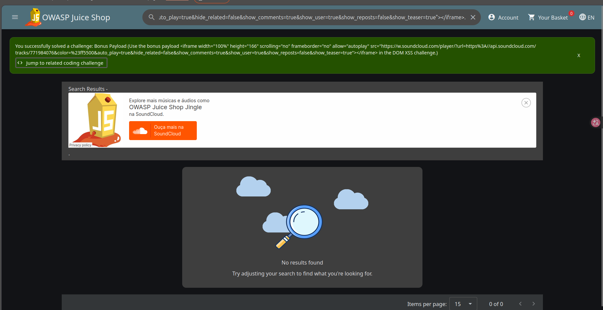
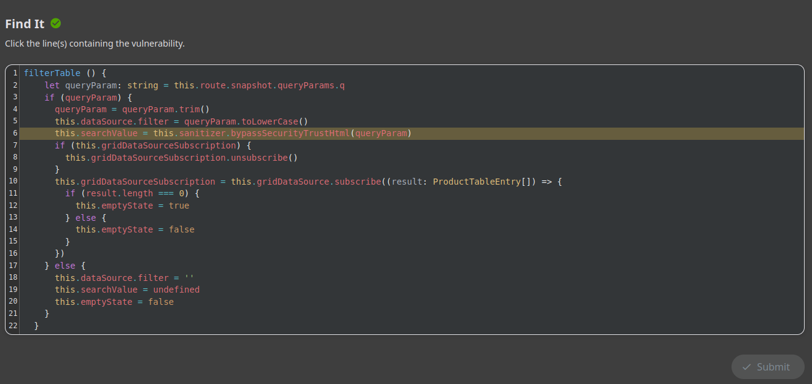
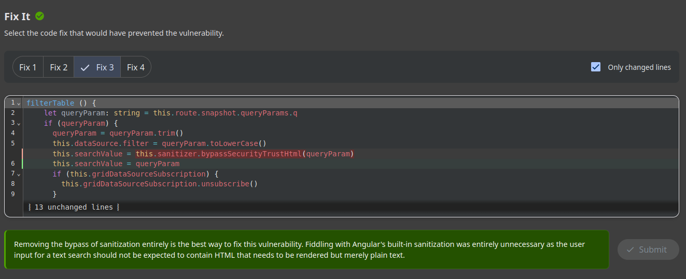

# Prova de Conceito (PoC): Injeção de Conteúdo e DOM XSS via Bonus Payload

---

**Autor:** Nicolas Matheus Lima Oliveira  
**Data:** 04/11/2026  
**Alvo:** OWASP Juice Shop (`http://localhost:3000`)  
**Desafio Realizado:** Bonus Payload (*Use the bonus payload `<iframe ... src="https://w.soundcloud.com/player/?url=...">` in the DOM XSS challenge*)  
**Categoria no Desafio:** XSS / Shenanigans / Code Analysis  

---

## 1. Identificação e Classificação da Vulnerabilidade

- **Classificação OWASP Top 10 (2021):** **A03:2021 – Injection** (Injeção)
- **Classificação Anterior OWASP Top 10 (2017):** A7:2017 – Cross-Site Scripting (XSS)
- **Classificação CWE:**
  - **CWE-79:** Improper Neutralization of Input During Web Page Generation ('Cross-site Scripting')
  - **CWE-116:** Improper Encoding or Escaping of Output
  - **CWE-1021:** Improper Restriction of Rendered UI Layers or Frames
- **Referência Oficial OWASP:** [DOM Based XSS Prevention Cheat Sheet](https://cheatsheetseries.owasp.org/cheatsheets/DOM_based_XSS_Prevention_Cheat_Sheet.html)

### O que é a vulnerabilidade?
A vulnerabilidade explorada é uma variação prática e avançada de **DOM-based Cross-Site Scripting (DOM XSS)** e **HTML/Frame Injection**. Ela decorre da incapacidade do cliente (navegador/aplicação SPA) de filtrar ou neutralizar elementos HTML arbitrários fornecidos por entradas não confiáveis antes de inseri-los no DOM.

Neste desafio em específico (**Bonus Payload**), demonstra-se como uma falha de DOM XSS não se limita apenas a disparar janelas de `alert()`, mas permite a **injeção de elementos complexos da UI** — no caso, um reprodutor de áudio externo incorporado (`<iframe>`) com parâmetros como `autoplay=true` originado do SoundCloud.

A causa raiz no código-fonte é idêntica ao desafio inicial de DOM XSS: o mecanismo de busca de produtos utiliza o método `bypassSecurityTrustHtml()` do `DomSanitizer` do Angular sobre o parâmetro `q` da URL, desativando intencionalmente os filtros de segurança do framework e permitindo que qualquer marcação HTML externa (incluindo iframes e players interativos de terceiros) seja interpretada e renderizada na aplicação.

---

## 2. Prova de Existência da Vulnerabilidade (Exploração)

### Carga Maliciosa (Bonus Payload)
O payload utilizado explora a injeção de uma tag `<iframe>` apontando para um player do SoundCloud com reprodução automática (*autoplay*):

```html
<iframe width="100%" height="166" scrolling="no" frameborder="no" allow="autoplay" src="https://w.soundcloud.com/player/?url=https%3A//api.soundcloud.com/tracks/771984076&color=%23ff5500&auto_play=true&hide_related=false&show_comments=true&show_user=true&show_reposts=false&show_teaser=true"></iframe>
```

### Vetores de Injeção:
1. **Campo de Pesquisa:**
   - Inserir o payload completo na barra de pesquisa no topo da aplicação.
2. **Via Parâmetro de URL Direto:**
   - Acessar a aplicação concatenando o payload codificado para URL no parâmetro `q`:
   ```text
   http://localhost:3000/#/search?q=%3Ciframe%20width%3D%22100%25%22%20height%3D%22166%22%20scrolling%3D%22no%22%20frameborder%3D%22no%22%20allow%3D%22autoplay%22%20src%3D%22https%3A%2F%2Fw.soundcloud.com%2Fplayer%2F%3Furl%3Dhttps%253A%2F%2Fapi.soundcloud.com%2Ftracks%2F771984076%26color%3D%2523ff5500%26auto_play%3Dtrue%26hide_related%3Dfalse%26show_comments%3Dtrue%26show_user%3Dtrue%26show_reposts%3Dfalse%26show_teaser%3Dtrue%22%3E%3C%2Fiframe%3E
   ```

### Evidência de Execução
Ao submeter o payload, o DOM renderiza imediatamente a moldura do SoundCloud executando o áudio temático do Juice Shop, comprovando a injeção de frames externos e validando a conclusão do desafio:



---

## 3. Desafio Interativo de Código (Coding Challenge)

Assim como nos desafios anteriores, a plataforma disponibiliza o exercício de engenharia reversa e análise de vulnerabilidade (*Find It* e *Fix It*).

### 3.1. Fase Find It (Localização da Linha Vulnerável)
Ao inspecionar a função `filterTable()` no componente de pesquisa (`search-result.component.ts`):

```typescript
filterTable () {
  let queryParam: string = this.route.snapshot.queryParams.q
  if (queryParam) {
    queryParam = queryParam.trim()
    this.dataSource.filter = queryParam.toLowerCase()
    this.searchValue = this.sanitizer.bypassSecurityTrustHtml(queryParam) // <-- LINHA VULNERÁVEL
    if (this.gridDataSourceSubscription) {
      this.gridDataSourceSubscription.unsubscribe()
    }
...
```

A chamada a `this.sanitizer.bypassSecurityTrustHtml(queryParam)` é o ponto vulnerável, pois instrui o framework a confiar incondicionalmente no código HTML recebido como parâmetro de busca.



---

### 3.2. Fase Fix It (Análise das Soluções Propostas)
Na etapa *Fix It*, o desafio apresenta diferentes hipóteses de correção:

1. **Opção 1 (Correção Definitiva e Correta):**
   - Remover completamente a chamada ao método de *bypass*, definindo:
     ```typescript
     this.searchValue = queryParam
     ```
   - O Angular passa a tratar o valor como texto simples (`DOMString`), realizando o escape automático de qualquer tag `<` ou `>`, impossibilitando tanto ataques de script quanto injeções de iframes externos.
2. **Opções Falsas / Inadequadas:**
   - **`bypassSecurityTrustResourceUrl()`**: Altera erroneamente o contexto de confiança para URLs de recursos, o que não faz sentido para o termo de pesquisa.
   - **`bypassSecurityTrustSoundCloud()`**: Suposta função fictícia para permitir apenas conteúdo do SoundCloud (não existe na API do Angular `DomSanitizer`).
   - **`bypassSecurityTrustIframe()`**: Outra função inexistente que tenta sugerir filtros baseados em tags específicas dentro do sanitizador nativo.



---

## 4. Como Corrigir (Remediação e Boas Práticas)

Para proteger aplicações web contra injeções de conteúdo arbitrário e DOM XSS:

1. **Remoção de Métodos de Bypass de Confiança:**
   - Nunca utilizar métodos da família `bypassSecurityTrust*` em dados recebidos direta ou indiretamente do usuário.
2. **Interpolação Segura por Padrão:**
   - Deixar que o template engine do Angular faça a sanitização padrão (`{{ searchValue }}`).
3. **Política de Segurança de Conteúdo (CSP - Content Security Policy):**
   - Restringir a origem de frames permitidos na aplicação por meio da diretiva `frame-src`. Por exemplo:
     ```http
     Content-Security-Policy: default-src 'self'; frame-src 'none';
     ```
     Caso a aplicação não deva carregar iframes de domínios como `w.soundcloud.com`, o navegador bloqueará o carregamento mesmo que a injeção ocorra no DOM.
4. **Sanitização com Allowlist Estrita (se HTML for imprescindível):**
   - Utilizar [DOMPurify](https://github.com/cure53/DOMPurify) configurado para descartar tags de iframe e objetos embutidos:
     ```typescript
     import DOMPurify from 'dompurify';
     this.searchValue = DOMPurify.sanitize(queryParam, { FORBID_TAGS: ['iframe', 'object', 'embed'] });
     ```

