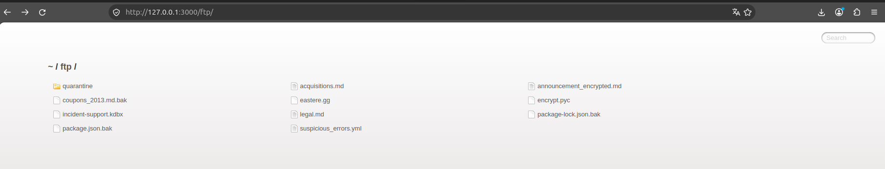
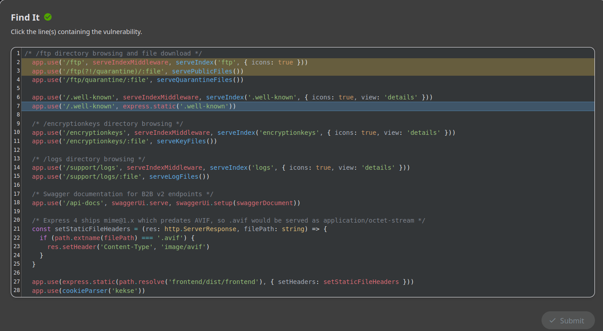
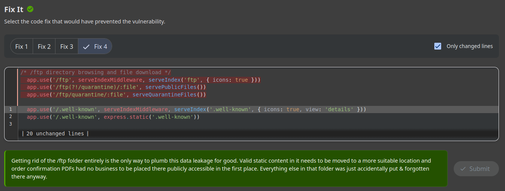

# Prova de Conceito (PoC): Exposição de Documento Confidencial (Directory Listing / Sensitive Data Exposure)

---

**Autor:** Nicolas Matheus Lima Oliveira  
**Data:** 04/11/2026  
**Alvo:** OWASP Juice Shop (`http://localhost:3000`)  
**Desafio Realizado:** Confidential Document (*Access a confidential document*)  
**Categoria no Desafio:** Sensitive Data Exposure / Security Misconfiguration / Code Analysis  

---

## 1. Identificação e Classificação da Vulnerabilidade

- **Classificação OWASP Top 10 (2021):** 
  - **A01:2021 – Broken Access Control** (Quebra de Controle de Acesso)
  - **A05:2021 – Security Misconfiguration** (Configuração Incorreta de Segurança)
- **Classificação OWASP Top 10 (2017):** **A3:2017 – Sensitive Data Exposure** (Exposição de Dados Sensíveis)
- **Classificação CWE:**
  - **CWE-548:** Exposure of Information Through Directory Listing
  - **CWE-200:** Exposure of Sensitive Information to an Unauthorized Actor
  - **CWE-219:** Storage of File with Sensitive Data Under Web Root

### O que é a vulnerabilidade?
A vulnerabilidade de **Exposição de Dados Sensíveis via Listagem de Diretórios (Directory Listing)** ocorre quando o servidor web ou a aplicação está configurado para exibir publicamente o índice do conteúdo de diretórios internos no sistema de arquivos quando nenhum arquivo padrão (como `index.html`) está presente, ou quando middlewares de navegação de diretórios (como `serve-index`) são habilitados inadvertidamente em rotas públicas.

Isso permite que qualquer atacante navegue pela árvore de arquivos da aplicação, identifique documentos confidenciais, backups (`.bak`), arquivos de configuração, bancos de dados, chaves criptográficas ou arquivos esquecidos em ambiente de produção sem qualquer barreira de autenticação ou autorização.

No OWASP Juice Shop, o endpoint `/ftp` foi exposto com o middleware `serveIndex('ftp', { icons: true })`, permitindo a navegação livre pelo diretório e o download direto do documento confidencial `acquisitions.md` (*Planned Acquisitions - This document is confidential! Do not distribute!*).

---

## 2. Prova de Existência da Vulnerabilidade (Exploração)

### Vetor de Descoberta e Exploração
1. **Identificação do Diretório Exposto:**
   Ao navegar para a rota pública de FTP na aplicação:
   ```text
   http://localhost:3000/ftp
   ```
   A aplicação retorna a listagem completa dos arquivos contidos na pasta `ftp`, incluindo:
   - `acquisitions.md` (Documento confidencial sobre aquisições planejadas)
   - `coupons_2013.md.bak` (Arquivos de backup)
   - `incident-support.kdbx` (Banco de dados de senhas KeePass)
   - `package.json.bak` / `suspicious_errors.yml`

2. **Download / Visualização do Arquivo Confidencial:**
   Ao clicar ou navegar diretamente para o arquivo:
   ```text
   http://localhost:3000/ftp/acquisitions.md
   ```
   O documento confidencial é retornado integralmente:
   ```markdown
   # Planned Acquisitions

   > This document is confidential! Do not distribute!

   Our company plans to acquire several competitors within the next year...
   ```
   Acessar este arquivo aciona e soluciona o desafio **Confidential Document**.

### Evidência de Execução
Abaixo consta a comprovação visual do acesso ao documento confidencial através do navegador e a notificação de resolução do desafio:



---

## 3. Desafio Interativo de Código (Coding Challenge)

O desafio disponibiliza a análise estática no código-fonte do servidor Node.js/Express, dividida nas fases **Find It** e **Fix It**.

### 3.1. Fase Find It (Localização das Linhas Vulneráveis)
Ao inspecionar a configuração de rotas e middlewares estáticos no servidor (`server.ts`):

```typescript
/* /ftp directory browsing and file download */
app.use('/ftp', serveIndexMiddleware, serveIndex('ftp', { icons: true })) // <-- LINHA VULNERÁVEL 1 (Directory Listing)
app.use('/ftp(?!/quarantine)/:file', servePublicFiles())                  // <-- LINHA VULNERÁVEL 2 (Download de Arquivos Públicos)
app.use('/ftp/quarantine/:file', serveQuarantineFiles())
```

As linhas responsáveis pela exposição são tanto o middleware que gera a listagem visual do diretório (`serveIndex('ftp', ...)`), quanto a rota que serve qualquer arquivo arbitrário contido nessa pasta sem restrição (`servePublicFiles()`).



---

### 3.2. Fase Fix It (Análise das Soluções Propostas)
Na etapa *Fix It*, o Juice Shop apresenta quatro cenários de correção:

1. **Opção 1 (Remoção Completa da Pasta `/ftp` - Solução Correta):**
   - Eliminar integralmente o endpoint `/ftp` e o compartilhamento de arquivos arbitrários. Documentos que realmente precisam ser acessados devem ser realocados para locais protegidos e estáticos específicos, e arquivos sensíveis (como relatórios confidenciais, backups e bases de incidentes) jamais devem residir dentro da raiz web pública.
2. **Opções Inadequadas ou Parciais:**
   - **Remover apenas o `serveIndex` (Opção 2):** Impede apenas a visualização da listagem de diretório, mas ainda permite que invasores façam download de arquivos confidenciais caso descubram ou adivinhem o nome dos arquivos (*Direct Object Reference / Security through Obscurity*).
   - **Remover apenas a rota de download de arquivos (Opção 3):** Mantém a listagem ativa expondo nomes de arquivos sensíveis desnecessariamente.
   - **Desativar apenas os ícones (`{ icons: false }`) (Opção 4):** Trata-se de alteração puramente visual/estética que mantém a vulnerabilidade 100% explorável.



---

## 4. Como Corrigir (Remediação e Boas Práticas)

Para proteger aplicações web contra Directory Listing e Exposição de Dados Sensíveis:

1. **Desativar a Listagem Automática de Diretórios:**
   - Em servidores web (Apache, Nginx, IIS) e middlewares Express (`serve-index`), desabilitar explicitamente a indexação de diretórios:
     - **Express:** Não registrar rotas com `serve-index` em ambientes produtivos.
     - **Nginx:** Manter `autoindex off;`.
     - **Apache:** Definir `Options -Indexes` no `httpd.conf` ou `.htaccess`.
2. **Nunca Armazenar Arquivos Confidenciais ou Backups na Raiz Web Pública:**
   - Arquivos como planilhas confidenciais, backups (`.bak`, `.old`), chaves criptográficas, bases de dados (`.kdbx`, `.sqlite`) e arquivos de dependência devem residir fora do diretório raiz servido pela aplicação (*web root*).
3. **Controle de Acesso Rígido para Download de Arquivos:**
   - Downloads de documentos e arquivos estáticos sensíveis devem sempre passar por rotas controladas com autenticação e autorização prévias, validando se o usuário possui permissão para aquele arquivo específico.
4. **Varredura e Auditoria Periódica:**
   - Implementar regras no pipeline de CI/CD para impedir que extensões perigosas (`.bak`, `.key`, `.kdbx`, `.sql`) sejam incluídas nos pacotes de deploy para produção.

