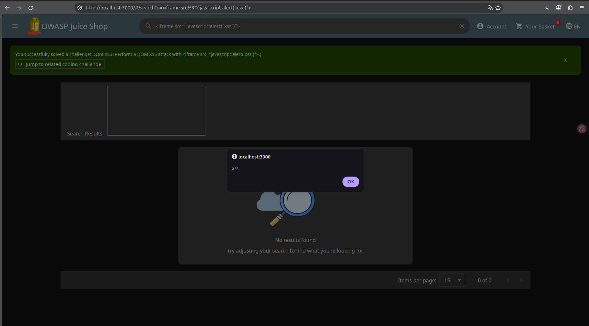
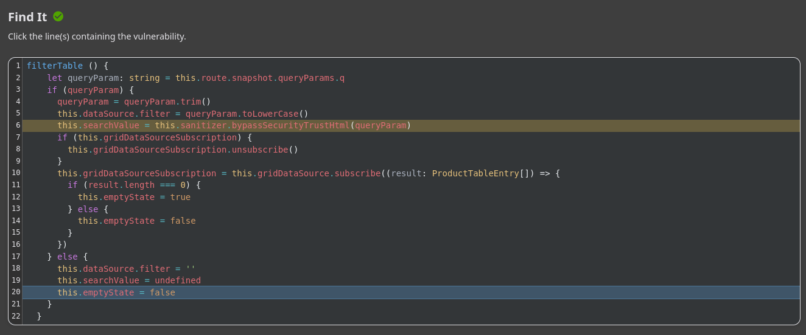
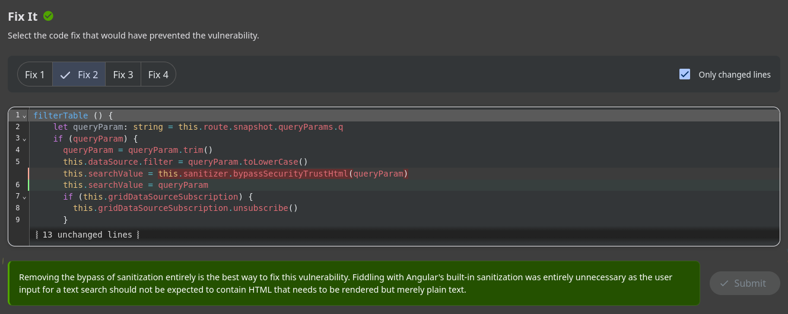

# Prova de Conceito (PoC): DOM-based Cross-Site Scripting (DOM XSS)

---

**Autor:** Nicolas Matheus Lima Oliveira  
**Data:** 04/11/2026  
**Alvo:** OWASP Juice Shop (`http://localhost:3000`)  
**Desafio Realizado:** DOM XSS (*Perform a DOM XSS attack with `<iframe src="javascript:alert(`xss`)">`*)  
**Categoria no Desafio:** XSS / Code Analysis  

---

## 1. Identificação e Classificação da Vulnerabilidade

- **Classificação OWASP Top 10 (2021):** **A03:2021 – Injection** (Injeção)
- **Classificação Anterior OWASP Top 10 (2017):** A7:2017 – Cross-Site Scripting (XSS)
- **Classificação CWE:**
  - **CWE-79:** Improper Neutralization of Input During Web Page Generation ('Cross-site Scripting')
  - **CWE-116:** Improper Encoding or Escaping of Output
- **Referência Oficial OWASP:** [DOM Based XSS Prevention Cheat Sheet](https://cheatsheetseries.owasp.org/cheatsheets/DOM_based_XSS_Prevention_Cheat_Sheet.html)

### O que é a vulnerabilidade?
O **DOM-based Cross-Site Scripting (DOM XSS)** ocorre quando uma aplicação web lê dados de uma fonte manipulável pelo usuário no cliente (chamada de *Source*, como `location.search`, parâmetros de URL ou `document.referrer`) e os repassa para um ponto de execução ou renderização no Document Object Model (chamado de *Sink*, como `innerHTML`, `document.write`, ou interpolações HTML não tratadas) sem sanitização ou codificação adequadas.

Diferente do XSS Refletido ou Armazenado, no DOM XSS a carga maliciosa (*payload*) é processada e executada inteiramente pelo motor JavaScript do navegador cliente, muitas vezes sem sequer interagir ou depender de reflexão direta por parte do backend.

No OWASP Juice Shop, a vulnerabilidade ocorre no campo de busca de produtos: a aplicação captura o parâmetro de consulta `q` da URL e, de forma insegura, neutraliza a proteção nativa do framework Angular chamando explicitamente o método `this.sanitizer.bypassSecurityTrustHtml(queryParam)` antes de renderizar o termo pesquisado na interface.

---

## 2. Prova de Existência da Vulnerabilidade (Exploração)

### Vetor de Ataque e Carga Maliciosa (Payload)
- **Payload utilizado:**
  ```html
  <iframe src="javascript:alert(`xss`)">
  ```
- **Ponto de Injeção (Source):** Campo de busca de produtos ou diretamente via parâmetro de URL (`q`).
- **URL de Reprodução:**
  ```text
  http://localhost:3000/#/search?q=%3Ciframe%20src%3D%22javascript%3Aalert(%60xss%60)%22%3E
  ```

### Passo a Passo da Exploração:
1. Acesse a aplicação em `http://localhost:3000`.
2. No campo de busca superior direito (ícone de lupa), insira o payload:
   ```html
   <iframe src="javascript:alert(`xss`)">
   ```
   e pressione `Enter`.
3. O script Angular processa a entrada, passa o valor pelo método `bypassSecurityTrustHtml` e renderiza o HTML diretamente no DOM.
4. O navegador cria a tag `<iframe>` cujo atributo `src` executa a pseudo-URL `javascript:`, disparando imediatamente uma caixa de alerta com a mensagem ``xss`` no contexto da sessão do usuário.

### Evidência de Execução
Abaixo consta a comprovação visual da execução do alerta JavaScript (*PoC*) e da notificação de conclusão do desafio pelo Juice Shop:



---

## 3. Desafio Interativo de Código (Coding Challenge)

O desafio conta com uma etapa de análise estática guiada no próprio Juice Shop dividida em **Find It** e **Fix It**.

### 3.1. Fase Find It (Localização da Linha Vulnerável)
Ao analisar o método `filterTable()` responsável pela filtragem e exibição do termo pesquisado:

```typescript
filterTable () {
  let queryParam: string = this.route.snapshot.queryParams.q
  if (queryParam) {
    queryParam = queryParam.trim()
    this.dataSource.filter = queryParam.toLowerCase()
    this.searchValue = this.sanitizer.bypassSecurityTrustHtml(queryParam) // <-- LINHA VULNERÁVEL
    if (this.gridDataSourceSubscription) {
      this.gridDataSourceSubscription.unsubscribe()
    }
...
```

A linha vulnerável é:
```typescript
this.searchValue = this.sanitizer.bypassSecurityTrustHtml(queryParam)
```
Nela, o desenvolvedor instrui explicitamente o Angular DomSanitizer a desativar suas verificações automáticas de segurança para aquele conteúdo HTML arbitrário vindo do usuário.



---

### 3.2. Fase Fix It (Seleção da Correção Correta)
Na fase *Fix It*, são avaliadas as alternativas de remediação:

1. **Alterar para `bypassSecurityTrustResourceUrl()` / `bypassSecurityTrustScript()` / `bypassSecurityTrustStyle()`:**
   - Trocar o contexto de bypass de segurança para URL, Script ou Estilos é conceitualmente incorreto e mantém o bypass arbitrário ativo de forma inadequada.
2. **Remover completamente o bypass de sanitização (Solução Correta):**
   - Atribuir o valor diretamente sem instruir bypass: `this.searchValue = queryParam`.
   - O Angular, por padrão, trata valores vinculados no template como texto puro (*data binding* padrão `{{ searchValue }}`), codificando automaticamente caracteres perigosos como `<`, `>`, `"` e `'`. Como termos de busca são textos comuns, não há necessidade de permitir renderização de marcação HTML.

```typescript
// Correção recomendada (Fix 2):
this.searchValue = queryParam
```



---

## 4. Como Corrigir (Remediação e Boas Práticas)

Para prevenir vulnerabilidades de DOM XSS em aplicações modernas:

1. **Evitar Métodos de Desativação de Segurança (*Bypass Sanitization*):**
   - Métodos como `bypassSecurityTrustHtml`, `bypassSecurityTrustScript`, `dangerouslySetInnerHTML` (React) ou `v-html` (Vue) nunca devem ser utilizados para receber entradas controladas pelo usuário.
2. **Utilizar Context-Aware Output Encoding:**
   - Confiar no sistema nativo de interpolação e *escapamento* do framework (`{{ queryParam }}` no Angular). O Angular trata todo o conteúdo interpolado como texto plano seguro.
3. **Se a Renderização de HTML for Estritamente Necessária:**
   - Empregar bibliotecas de sanitização robustas e ativamente mantidas, como o [DOMPurify](https://github.com/cure53/DOMPurify), antes de inserir qualquer fragmento no DOM:
     ```typescript
     import DOMPurify from 'dompurify';
     this.searchValue = DOMPurify.sanitize(queryParam);
     ```
4. **Implementar Content Security Policy (CSP):**
   - Configurar cabeçalhos HTTP de CSP estritos, desabilitando a execução de scripts inline e pseudo-protocolos `javascript:` (ex: `script-src 'self' 'nonce-...'`).
5. **Princípio da Validação Estrita de Entrada:**
   - Validar formatos, tamanhos e caracteres permitidos antes de processar qualquer parâmetro de busca.

