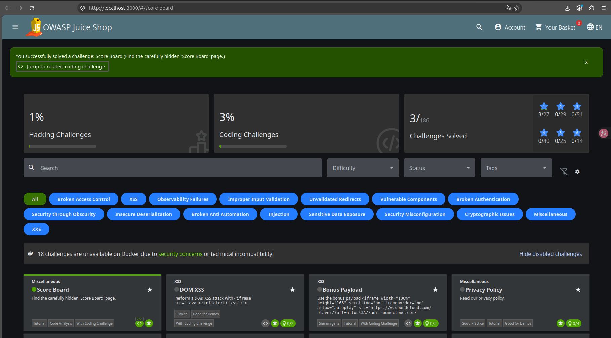
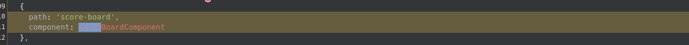

# Prova de Conceito (PoC): Acesso Indevido ao Score Board

---

**Autor:** Nicolas Matheus Lima Oliveira  
**Data:** 04/11/2026  
**Alvo:** OWASP Juice Shop (`http://localhost:3000`)  
**Desafio Realizado:** Score Board (*Find the carefully hidden 'Score Board' page*)  
**Categoria no Desafio:** Miscellaneous / Code Analysis / Broken Access Control  

---

## 1. Identificação e Classificação da Vulnerabilidade

- **Classificação OWASP Top 10 (2021):** **A01:2021 – Broken Access Control** (Quebra de Controle de Acesso)
- **Classificação Adicional / Vetores Associados:** 
  - **A05:2021 – Security Misconfiguration** (Segurança por Obscuridade / *Security through Obscurity*)
  - **CWE-200:** Exposure of Sensitive Information to an Unauthorized Actor
  - **CWE-284:** Improper Access Control
  - **CWE-656:** Reliance on Security Through Obscurity

### O que é a vulnerabilidade?
A vulnerabilidade de **Quebra de Controle de Acesso (Broken Access Control)** ocorre quando a aplicação web falha em impor restrições adequadas sobre o que usuários autenticados ou anônimos têm permissão para visualizar e executar.

Neste cenário específico, o painel do **Score Board** (placar com status de todos os desafios, pontuações e pistas do Juice Shop) é uma rota funcional que não possuía link visível nos menus de navegação da interface com o intuito de permanecer "escondida". Os desenvolvedores confiaram em **segurança por obscuridade** (*Security Through Obscurity*), presumindo que ocultar o botão na UI seria suficiente para impedir o acesso. 

Contudo, como o mapeamento de rotas do lado cliente (*front-end routing* em Angular) expõe as rotas completas nos bundles JavaScript e a rota `/score-board` não possui qualquer verificação de autorização (*Guards* ou checagem de permissão no backend/frontend), qualquer visitante não autenticado é capaz de acessar e interagir diretamente com o recurso.

---

## 2. Prova de Existência da Vulnerabilidade (Exploração)

### Vetor de Descoberta e Acesso Direto
1. **Inspeção do Código-Fonte do Cliente (SPA / Angular):**
   Ao analisar os arquivos JavaScript servidos publicamente pela aplicação (ex: `main.js`), observa-se a definição das rotas da aplicação sem ofuscação ou restrição de escopo:
   ```typescript
   {
     path: 'score-board',
     component: ScoreBoardComponent
   }
   ```
2. **Navegação Direta:**
   Ao navegar diretamente via barra de endereços para a URL:
   ```text
   http://localhost:3000/#/score-board
   ```
   A aplicação processa a requisição sem exigir autenticação ou privilégios de administrador, renderizando integralmente a interface do Score Board e notificando a conclusão do desafio.

### Evidência de Descoberta e Acesso
Abaixo consta a comprovação visual do acesso direto à tela do Score Board:



---

## 3. Desafio Interativo de Código (Coding Challenge)

O desafio do OWASP Juice Shop disponibiliza uma etapa de correção e análise estática guiada, composta por:
1. **Find It:** Identificação da linha vulnerável no código-fonte.
2. **Fix It:** Seleção da melhor estratégia de mitigação e correção do problema.

### 3.1. Fase Find It (Localização da Linha Vulnerável)
Na fase *Find It*, foi identificada a declaração da rota no arquivo de rotas da aplicação frontend (`routes.ts`):

```typescript
{
  path: 'score-board',
  component: ScoreBoardComponent
}
```



### 3.2. Fase Fix It (Análise das Soluções Propostas)
Na fase *Fix It*, são avaliadas três abordagens de modificação de código:

1. **Opção 1 (Solução Adequada no Contexto do Desafio / Aplicação):**
   - Manter a rota intacta com comentário explicativo de que ela é mandatória para o acompanhamento dos desafios da plataforma pedagógica (`// Must remain as is! Needed for challenge tracking!`).
2. **Opção 2 (Ofuscação de Rota via Base64):**
   - Transformar o caminho em `atob('c2NvcmUtYm9hcmQ=')`. Esta abordagem viola o princípio fundamental de segurança: **ofuscação não é segurança**. Qualquer invasor pode decodificar strings Base64 trivialmente.
3. **Opção 3 (Remoção da Rota):**
   - Deletar a rota do `routes.ts`. Apesar de eliminar o acesso, destrói completamente a funcionalidade do sistema (*Denial of Service* funcional).


---

## 4. Como Corrigir (Remediação e Boas Práticas)

Para aplicações em ambiente de produção contendo painéis administrativos ou recursos sensíveis:

1. **Implementar Controle de Acesso Baseado em Papéis (RBAC / ABAC):**
   - No frontend (Angular): Utilizar `canActivate` com guardas específicos (ex.: `AdminGuard`, `AuthGuard`), garantindo que a rota sequer seja inicializada por perfis não autorizados:
     ```typescript
     {
       path: 'score-board',
       component: ScoreBoardComponent,
       canActivate: [AdminGuard]
     }
     ```
2. **Validação Obrigatória no Lado do Servidor (Backend):**
   - Nunca confiar exclusivamente na lógica ou ocultação do cliente. Todas as APIs e dados consumidos pela rota devem validar tokens (JWT, Sessões) e autorizações nos endpoints REST/GraphQL correspondentes.
3. **Não Depender de Segurança por Obscuridade:**
   - URLs "secretas", nomes complexos ou ausência de botões no menu principal **não** constituem controles de segurança válidos.
4. **Princípio do Privilégio Mínimo (PoLP):**
   - Todo recurso e rota deve ser fechado por padrão (*Deny by Default*), concedendo permissões explícitas apenas aos usuários que realmente necessitam.

